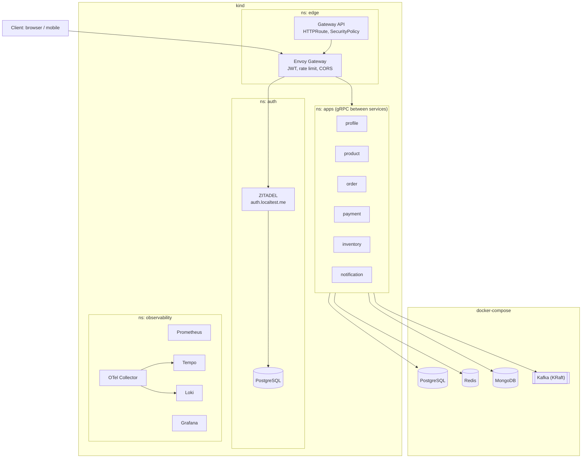

# Deployment diagram: Local (kind + docker-compose)

- kind runs Envoy Gateway, ZITADEL with its own PostgreSQL, the microservices and the whole observability stack.
- docker-compose runs only the stateful stores: PostgreSQL, Redis, MongoDB and Kafka (KRaft).
- All kind-to-compose traffic flows outward from the cluster.
