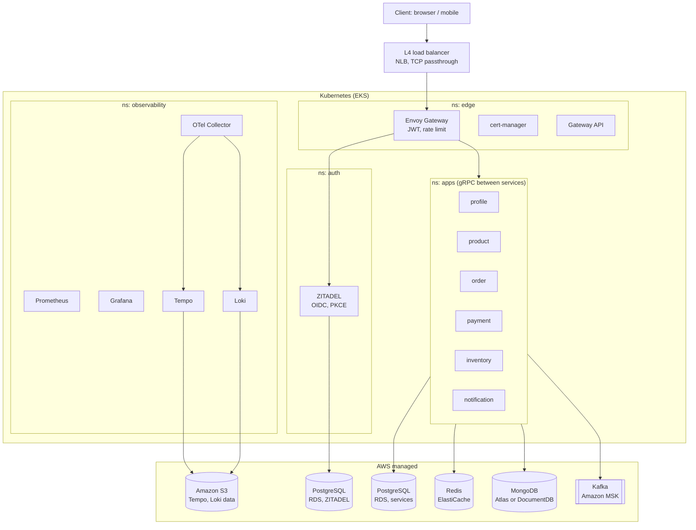

# Deployment diagram: Staging and Production (EKS + AWS managed services)

- Staging and production share this layout; staging uses the smallest instance sizes.
- The observability stack runs in the same cluster; Tempo and Loki keep their data in S3.
- Databases, cache, Kafka and S3 are AWS managed services outside the cluster.
